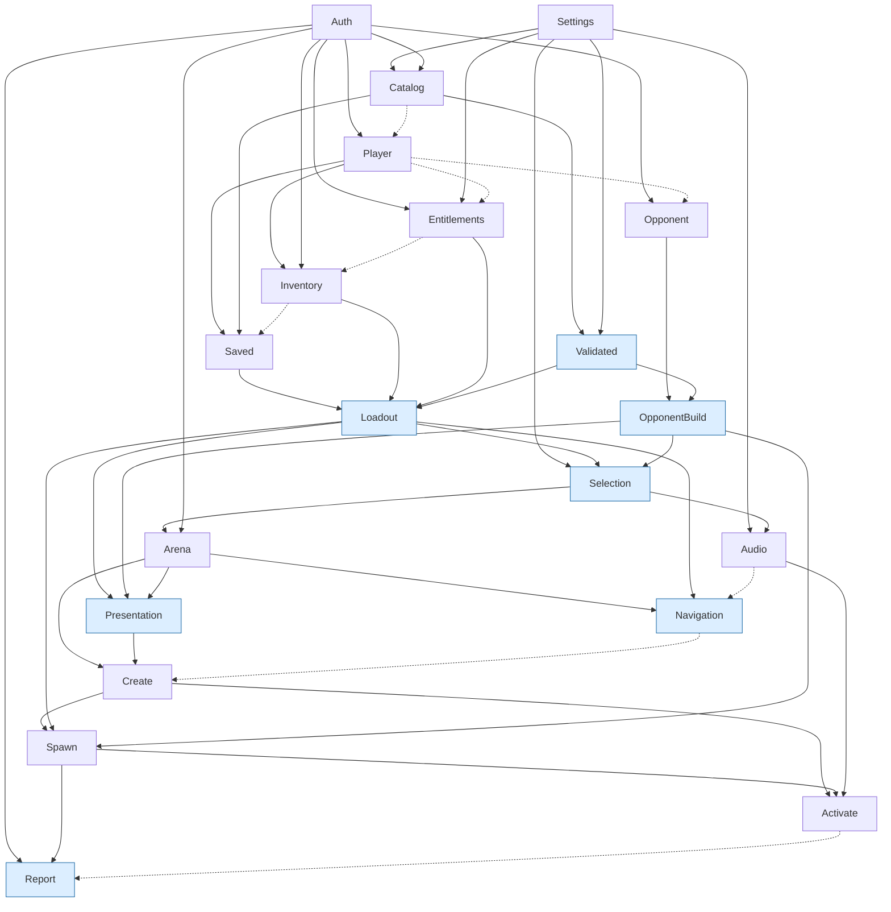

# Twenty-step match preparation

Run **Tools > Structured Process > Run 20-step match example**. This example simulates I/O and performs small CPU calculations; it does not contact a server or create scene objects. The console prints every step's start/end time and thread IDs, plus a summary of overlap and dependency counts.

`PrepareMatchProcess` contains 20 step occurrences, including two independently identified occurrences of `FetchMatchProfileStep`. Thirteen steps use the main thread and seven permit background execution. Settings, session and final readiness bind by their unique types. Other products share `WorkProduct` and bind through data IDs. Profile occurrences override their local IDs through aliases.

| Step | Thread | Data dependencies | Additional `After` |
| --- | --- | --- | --- |
| Load settings | Main | — | — |
| Authenticate | Main | — | — |
| Fetch catalog | Main | Settings, session | — |
| Player profile | Main | Session | Catalog |
| Opponent profile | Main | Session | Player profile |
| Validate catalog | Any | Catalog, settings | — |
| Fetch entitlements | Main | Session, settings | Player profile |
| Fetch inventory | Main | Player profile, session | Entitlements |
| Load saved loadout | Main | Player profile, catalog | Inventory |
| Resolve loadout | Any | Saved loadout, inventory, entitlements, validated catalog | — |
| Resolve opponent | Any | Opponent profile, validated catalog | — |
| Select arena | Any | Settings, loadout, opponent build | — |
| Download arena | Main | Selection, session | — |
| Load audio | Main | Settings, selection | — |
| Build navigation | Any | Arena data, loadout | Audio |
| Bake presentation | Any | Loadout, opponent build, arena data | — |
| Create arena | Main | Arena data, presentation | Navigation |
| Spawn participants | Main | Arena handle, loadout, opponent build | — |
| Activate match | Main | Arena handle, participants, audio | — |
| Report ready (optional) | Any | Session, participants | Activation |

Solid edges below come from data. Dashed edges are explicit completion dependencies. Background steps are highlighted.

`MatchPreparationWork.Validate` checks the actual trace after completion: all declarations ran once, each input producer and explicit predecessor finished before its consumer began, and each step used its expected thread. The trace also records how many operations overlapped, including asynchronous operations on the main thread.

The generated method has `task0` through `task19`. These are implementation-local numbers assigned after dependency ordering, not public step IDs. Adding a step can change them. Each variable retains its own `Task<StepResult<ThatStep.Output>>` type; the scheduler's base `Task` collection only waits for completions. Generated flow grows with the number of steps and dependency edges.
